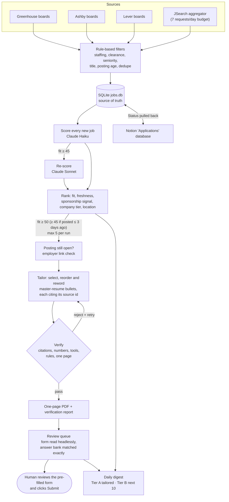

# Job Search Agent

[](https://github.com/sainithya-2001/job-search-agent/actions/workflows/tests.yml)
[](https://github.com/sainithya-2001/job-search-agent/actions/workflows/docker.yml)


Every weekday morning this agent pulls about 8,000 postings from 119 company job boards, throws out the 99% that
don't fit (staffing agencies, clearance jobs, wrong seniority, stale postings), and has Claude score the rest
against a master resume. For the best matches it tailors a one-page resume, and every bullet on it must cite the
master-resume entry it came from. A verifier rejects any number, tool or claim it can't trace. It then reads the
application form, pre-fills what it can answer exactly, and stops. A person reviews the form and clicks Submit.
Job searching is a high-volume, repetitive task where a confident wrong answer (an invented skill, a wrong
checkbox) costs more than the time saved, so the design goal is to automate the volume and keep a human on every
decision that leaves the machine.

## Architecture



A plain tool-use loop (`src/agent.py`, no framework) drives the daily cycle: Claude calls `search_jobs`,
`score_jobs`, `tailor_resume` and `log_application`. Every limit (cost, tool calls, thresholds, failures) is
enforced in code, not in the prompt. All model calls go through one provider interface (`src/llm.py`), so
switching between Claude and Gemini is one line in `config.yaml`.

[`ARCHITECTURE.md`](ARCHITECTURE.md) follows one real job through every step, naming the file and function, the
design decision and the alternative rejected.

## How each phase works

1. **Ingest.** Public board APIs for Greenhouse, Lever and Ashby, plus JSearch as an optional aggregator.
   - Everything is normalized to one `Job` model.
   - The posting date is always the original publish date, never "last updated".
   - Rule-based filters run before any LLM call: staffing firms, citizenship or clearance requirements, excluded
     titles and seniority, postings older than 14 days, duplicates.
   - A JSearch job is kept only if its apply link goes to the employer's own site or ATS, never a repost board.
   - JSearch runs on a hard request budget (7 per day, stop at 160 per month, never above 200). Each request is
     recorded in the database before it is sent.
2. **Score.** Claude Haiku scores every new job against the master resume and returns structured JSON: fit
   0–100, role family, matched skills, gaps, staffing flag, seniority check, a sponsorship quote, and a one-line
   reason.
   - Jobs at 45+ are re-scored by Claude Sonnet.
   - A cost estimate prints before the run, and the run stops at the cap.
   - Ranking orders by fit, then freshness, sponsorship signal, company tier and location.
3. **Tailor.** The model may only select, reorder and reword bullets that exist in `master_resume.yaml`, and
   each bullet cites its source ids.
   - The summary is never generated: code picks a pre-approved one by role family.
   - Before drafting, ATS keywords are extracted from the posting. Code decides which ones the resume actually
     supports, using exact matches, approved aliases, or bullet text.
   - The draft is rendered to PDF with headless Chromium. Content is cut until it fits one page, and nothing is
     ever added.
4. **Agent loop.** A readable tool-use loop with hard limits: $0.50 per run, 30 tool calls, stop after a tool
   fails twice in a row, at most 5 resumes per run.
   - Each posting is checked for closure before tailoring, so nothing is spent on closed jobs.
   - Every tool call is logged with arguments, latency, tokens and cost.
   - The run writes a daily digest: Tier A is what was tailored, Tier B is the next 10 ranked jobs and why they
     weren't tailored.
5. **Apply (review mode).** `queue` reads each application form headlessly and matches questions against an
   answer bank. Matching is exact text only: no fuzzy or LLM matching.
   - `review` opens the form in a visible browser, pre-fills the exact matches, attaches the verified PDF, lists
     what's left, and hands over.
   - The snapshot taken after pre-fill is compared with the one at the human's Submit click, so the log shows
     whether answers were approved unchanged or edited.
   - Applications sync to a Notion database. A Status changed in Notion (interviewing, offer, rejected) flows
     back into SQLite on the next run.
6. **Evals and deploy.** `evals/run_evals.py` compares scores with hand labels (results below). Two GitHub
   Actions workflows (tests, Docker build) run on every push.
   - A slim, non-root Docker image runs the headless commands.
   - The daily run is scheduled locally with Task Scheduler, because it needs the personal data and API keys.

## Guardrails

- **Citation-based verification, no invented claims.** Every tailored bullet cites master-resume ids, and
  `src/verify.py` rejects the draft if a bullet:
  - contains a number not in its sources;
  - names a tool not in its sources;
  - cites an id that doesn't exist;
  - merges two bullets about the same work;
  - breaks a rule (required bullet, headline labels, no seniority words, years-of-experience wording must match the master resume exactly).

  A second LLM call fact-checks the claims, and failures are retried. Example rejection, from the sample resume:

  ```
  exp_northwind bullet 1: number(s) not in cited sources: ['18', '5']
  rules: must include a bullet citing exp_northwind_b02 for this role
  ```
- **The model never sees contact details**, and summaries are pre-approved text, never generated. Any master-resume
  field with an unresolved conflict makes loading fail rather than letting the model guess.
- **Cost caps in code.**
  - $0.50 per agent run, with a share reserved so scoring can't starve tailoring.
  - $0.50 per scoring run and $0.75 per manual tailoring run.
  - An estimate prints before each run and the actual cost after.
  - The JSearch request budget is recorded before each request is sent.
- **No auto-submit.**
  - No code clicks a submit control: `safe_click` refuses submit-like buttons, and form submission is blocked
    while the agent fills.
  - The auto-submit gates (fit ≥ 70, every question matched exactly, no CAPTCHA, per-company limits) run in
    shadow mode only. They record whether an application *would* qualify. `auto_submit: true` is rejected at
    startup.
- **CAPTCHA policy.** Never solved or bypassed. A form with any CAPTCHA goes to the human like every other form.
  The agent also never touches LinkedIn or Indeed.
- **Personal data stays out of the repo.**
  - The master resume, answer bank, database, backups, generated resumes and logs live in gitignored `data/`,
    `output/` and `logs/`.
  - Personal tailoring rules live in `config.local.yaml` (gitignored, deep-merged over `config.yaml`).
  - CI fails if any of these is ever tracked. The Docker workflow builds the image and fails if it contains
    `.env`, `data/`, `output/`, `logs/` or tests. Personal data is mounted at runtime, never copied in.
  - Tests use fictional placeholders and never read the local config.
  - The full git history was scanned for keys, emails, phone numbers and resume content before the repo went
    public.

## Evaluation

`evals/run_evals.py` compares the agent's fit scores with hand labels (apply / maybe / skip) on the same jobs. It
is run before and after any scoring-prompt change. Scores are cached per model and prompt version, so re-running
is free until the prompt changes. `python evals/label.py` labels jobs one at a time in the terminal.

**Sample:** 30 already-scored jobs, labeled blind (company, title, link and a neutral two-line summary; no model
score). They were sampled evenly across fit bands (<40, 40–54, 55–64, 65+) and role families. Labels: 16 apply,
3 maybe, 11 skip. This is a small sample, and it holds more low-scoring jobs than the real pool does, so treat it
as a direction. It will be re-run as more jobs are labeled.

**Results (first run, 2026-10-12):**

- **Precision 100% at the old 65 cutoff:** no job labeled skip (or maybe) was recommended for tailoring. All of
  the scorer's misses went the other way: it was too strict, and only 7 of the 16 "apply" jobs reached 65.
- **Rank correlation 0.68** (Spearman, pipeline score vs label). The model orders jobs much like the hand labels
  do, on a scale that sits lower.
- Haiku alone and Sonnet alone scored about the same (rank correlation 0.69 and 0.68).

**Tailoring cutoff, before** (Haiku first, re-scored by Sonnet at 60+; precision and recall of "apply"):

| Cutoff | Precision | Recall | F1 | Jobs tailored (of 30) |
|---|---|---|---|---|
| 43 | 78% | 88% | 0.82 | 18 |
| 50 | 81% | 81% | 0.81 | 16 |
| 55 | 80% | 75% | 0.77 | 15 |
| 60 | 100% | 56% | 0.72 | 9 |
| 65 (old) | 100% | 44% | 0.61 | 7 |

**Changes made from these results:**
- Tailor at fit ≥ 50 (was 65), and ≥ 45 for jobs posted in the last 3 days (was 58).
- Sonnet re-scores at 45+ (was 60), so borderline jobs get a second look.
- Full-stack titles stay excluded, and the filter now catches every spelling ("Fullstack", "Full Stack",
  "Full-Stack").

**After the changes** (same 30 jobs, Sonnet re-scoring at 45+):

| Cutoff | Precision | Recall | F1 | Jobs tailored (of 30) |
|---|---|---|---|---|
| 45 (fresh jobs) | 87% | 81% | 0.84 | 15 |
| 50 (new) | 86% | 75% | 0.80 | 14 |
| 55 | 85% | 69% | 0.76 | 13 |
| 60 | 100% | 62% | 0.77 | 10 |
| 65 (old) | 100% | 50% | 0.67 | 8 |

At the new cutoff of 50 the agent now tailors 14 of the 30 jobs instead of 7. 12 of those 14 are jobs labeled
apply: recall rises from 44% to 75% while precision drops from 100% to 86%: a deliberate trade-off, since a tailored resume for a weak fit costs about $0.07 and a missed good job costs an application. Rank correlation is unchanged (0.67), and
agreement on the three labels is 73%. Full output: [`evals/results.md`](evals/results.md).

## Metrics

From the first scheduled runs (October 2026):

| Metric | Value |
|---|---|
| Postings searched per run | ~8,200 (119 company boards: 86 Ashby, 33 Greenhouse; plus JSearch) |
| Passing the hard filters | ~60 per run (~0.7%) |
| Cost per run, no new jobs | ~$0.001 |
| Cost per run, with 1–2 tailored resumes | $0.12–$0.19 (cap: $0.50) |
| Scoring cost | ~$0.003–$0.007 per job (Haiku, Sonnet on 45+) |
| Tailoring cost | ~$0.05–$0.09 per verified one-page resume |
| Tests | 396 (pytest; no network, no API keys) |
| CI | [tests](https://github.com/sainithya-2001/job-search-agent/actions/workflows/tests.yml) and [docker](https://github.com/sainithya-2001/job-search-agent/actions/workflows/docker.yml) on every push and PR |

## Quickstart

Runs on a fictional sample candidate, so no personal data is needed. Requires Python 3.11+.

```bash
git clone https://github.com/sainithya-2001/job-search-agent.git
cd job-search-agent
python -m venv .venv
source .venv/bin/activate              # Windows: .venv\Scripts\activate
pip install -r requirements.txt
python -m playwright install chromium

# Personal files are gitignored; start from the committed examples.
cp .env.example .env                                         # add ANTHROPIC_API_KEY; the rest are optional
cp config.local.example.yaml config.local.yaml               # tailoring rules for the sample resume
cp data/master_resume.example.yaml data/master_resume.yaml   # fictional candidate "Alex Example"
cp data/answer_bank.example.yaml data/answer_bank.yaml       # form answers (used by queue/review)

python -m pytest -q             # 396 tests, no keys needed
python main.py search           # fetch + filter + save; public board APIs, no keys needed
python main.py run --dry-run    # plan and cost estimate: no LLM calls, no database writes (key must be set)
python main.py run              # full daily cycle (never applies); writes output/digest_YYYY-MM-DD.md
python main.py review           # open the next queued form pre-filled; you review and submit
```

Optional services:
- `JSEARCH_API_KEY` (RapidAPI free plan) adds the aggregator source.
- `NOTION_TOKEN` plus `NOTION_PARENT_PAGE_ID` turn on the Notion sync. Connect the integration to the page first.

Without them those steps are skipped. Company boards, roles, filters, thresholds and caps are all in
`config.yaml`.

**Other commands:**
- `score` and `tailor <job_id> --pdf` run single steps.
- `digest` and `skills-gap` write reports.
- `keywords` checks ATS coverage.
- `queue`, `confirm <job_id> --applied|--skipped` and `status <job_id> interviewing` manage applications.
- `close <job_id>` marks a posting closed. `notion-sync` syncs by hand.

**Docker** runs the headless commands only. `review` needs a visible browser, so it runs on the host:

```bash
docker build -t job-agent .
docker run --rm --env-file .env \
  -v "$PWD/data:/app/data" -v "$PWD/output:/app/output" -v "$PWD/logs:/app/logs" \
  -v "$PWD/config.local.yaml:/app/config.local.yaml:ro" \
  job-agent run --dry-run
```

## MCP server

`src/mcp_server.py` exposes the pipeline's state to any MCP client (Claude Desktop, Claude Code) over stdio, so you
can ask "what did today's run find?" or "what's the status of my applications?" in a chat.

| Tool | What it returns |
|---|---|
| `get_digest(date)` | The daily digest for `YYYY-MM-DD` (default: the latest); built in memory if that day has no file |
| `list_ranked_jobs(limit)` | Scored jobs in the pipeline's ranking order (closed, applied, skipped and stale left out); 1–50 |
| `get_job(job_id)` | The posting, its score and reasoning, the application row, and the review-queue summary |
| `get_application_status()` | Every application with its status, plus counts per status |
| `run_search_dry_run()` | Fetches the boards now and applies the filters: fetched, passed, filtered out by reason, would-be-new |

**Read-only by construction.**
- `jobs.db` is opened with SQLite `mode=ro`, so any write raises.
- `.env` is never loaded, so the server process holds no API key to spend.
- No tool calls the LLM, tailoring, form-filling or apply code.
- The dry-run search never saves and never calls JSearch.
- `tests/test_mcp_server.py` makes every one of those entry points raise, calls all five tools, and checks the
  database bytes are unchanged. Pre-filled form answers are never returned.

**Connect it to Claude Desktop:** Settings → Developer → Edit Config opens `claude_desktop_config.json`. Add the
server with absolute paths to the venv's Python and the script, then restart Claude Desktop:

```json
{
  "mcpServers": {
    "job-search-agent": {
      "command": "C:\\path\\to\\job-search-agent\\.venv\\Scripts\\python.exe",
      "args": ["C:\\path\\to\\job-search-agent\\src\\mcp_server.py"]
    }
  }
}
```

On macOS or Linux use `/path/to/job-search-agent/.venv/bin/python` and `/path/to/job-search-agent/src/mcp_server.py`.
The tools appear under the connectors (tools) menu in a new chat. The server finds `data/` and `output/` relative
to the script, so no working directory is needed.

**Claude Code:** `claude mcp add job-search-agent -- /path/to/.venv/bin/python /path/to/src/mcp_server.py`

## Tech stack

- **Python 3.11**, httpx, pydantic (structured models), SQLite (`sqlite3`), PyYAML.
- **LLMs:** Anthropic API: Claude Haiku 5.5 for first-pass scoring and the agent loop, Claude Sonnet 5.5 for
  re-scoring, tailoring and the fact-check. Google Gemini is the alternate provider behind the same interface.
- **Playwright + headless Chromium:** resume PDFs (Jinja2 HTML template) and application-form reading and
  pre-filling.
- **Notion API** over plain httpx (no SDK).
- **MCP Python SDK** (`mcp`) for the read-only MCP server.
- **pytest; GitHub Actions; Docker** (`python:3.11-slim`).

## Project structure

```
job-agent/
  main.py                  # CLI: search | score | tailor | run | digest | queue | review | confirm | status | ...
  config.yaml              # provider + models, roles, filters, thresholds, cost caps, company board list
  config.local.example.yaml
  CLAUDE.md                # the build spec, phase by phase
  data/                    # gitignored, except the two examples
    master_resume.example.yaml
    answer_bank.example.yaml
  src/
    sources/               # greenhouse.py, lever.py, ashby.py, jsearch.py
    filters.py             # rule-based exclusions before any LLM call
    store.py               # SQLite: jobs, scores, applications, JSearch budget, Notion sync state
    llm.py                 # provider interface: structured JSON, tool calling, retry/backoff, cost
    scorer.py              # fit scoring + ranking
    keywords.py            # ATS keyword extraction; code decides what the resume supports
    tailor.py              # draft from cited master-resume bullets
    verify.py              # citation, number, tool and rule checks + LLM fact-check
    render.py              # HTML -> one-page PDF
    linkcheck.py           # posting open? employer link real?
    agent.py               # plain tool-use loop with hard limits
    digest.py              # daily Tier A / Tier B digest
    answers.py, forms.py   # exact-match answer bank; read and pre-fill Greenhouse/Lever/Ashby forms
    gates.py               # shadow-mode auto-submit gates (no submit code)
    apply.py               # queue, review, confirm, status
    notion.py, backup.py   # Notion sync; dated jobs.db backups
    mcp_server.py          # MCP server: read-only tools for Claude Desktop / Claude Code
  templates/resume.html.j2
  evals/                   # run_evals.py, label.py, label_me.csv, results.md
  tests/                   # 396 tests, fictional fixtures
  .github/workflows/       # tests.yml, docker.yml
  Dockerfile
```

## How this was built

I designed the system: the architecture, guardrails, evaluation method, and every threshold change. I wrote the
phase-by-phase spec in [CLAUDE.md](CLAUDE.md) and used [Claude Code](https://claude.com/claude-code) to implement
it, reviewing each phase before the next began. I hand-labeled the eval set and made the trade-off calls:
review-only applying, citation verification, exact-match answers, and cost caps enforced in code.

## Limitations and next steps

**Limitations**
- **Small eval set.** 30 hand-labeled jobs. The numbers are a direction, not a benchmark.
- **Board coverage.** Only companies on Greenhouse, Lever or Ashby are searched directly. Workday and other ATS
  jobs come only through JSearch, and those forms can't be pre-filled, so they're flagged "apply manually".
- **Exact matching is strict by design.** Any question worded differently from the answer bank is left for the
  human, so pre-fill coverage depends on how well the bank is filled in.
- **The LLM fact-check is a second opinion, not a proof.** The string checks catch numbers and tool names.
  Subtler rewording that changes a claim's meaning relies on the model check and the human review.
- **Single user, local schedule.** The daily run needs personal data and keys, so it runs on a local scheduler,
  not in CI.

**Next steps**
- **MCP actions behind confirmation.** The MCP server is read-only today. A next step is letting a client queue a
  job for tailoring, with the same cost caps and a human confirmation on every call.
- **Langfuse tracing.** Replace the JSONL tool-call logs with traces per run: prompts, tokens, cost, latency and
  verifier outcomes. That would make prompt changes comparable over time.
- **Bigger eval set.** Label more jobs and re-run the eval on every scoring-prompt change. Add an eval for the
  tailoring verifier itself (seeded bad drafts it must reject).
